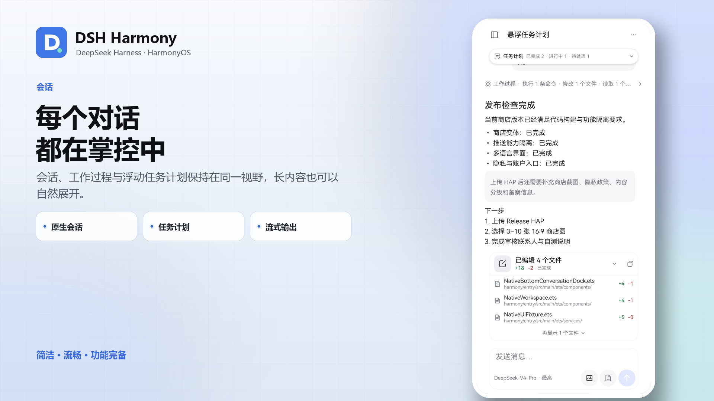
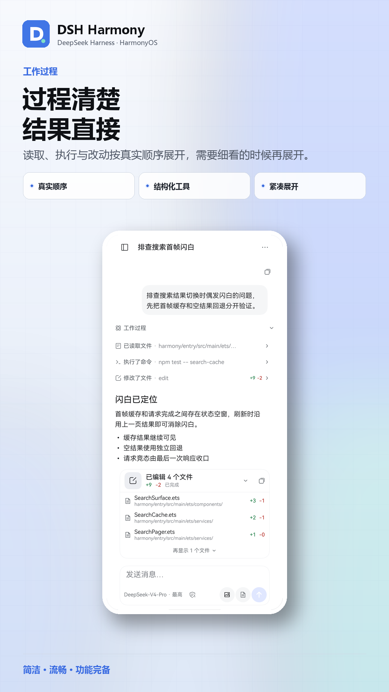
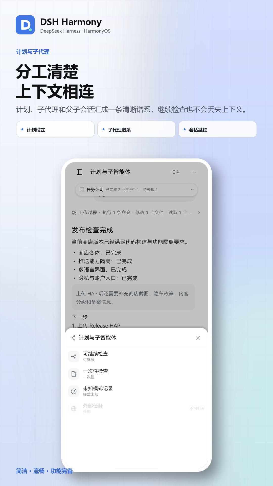
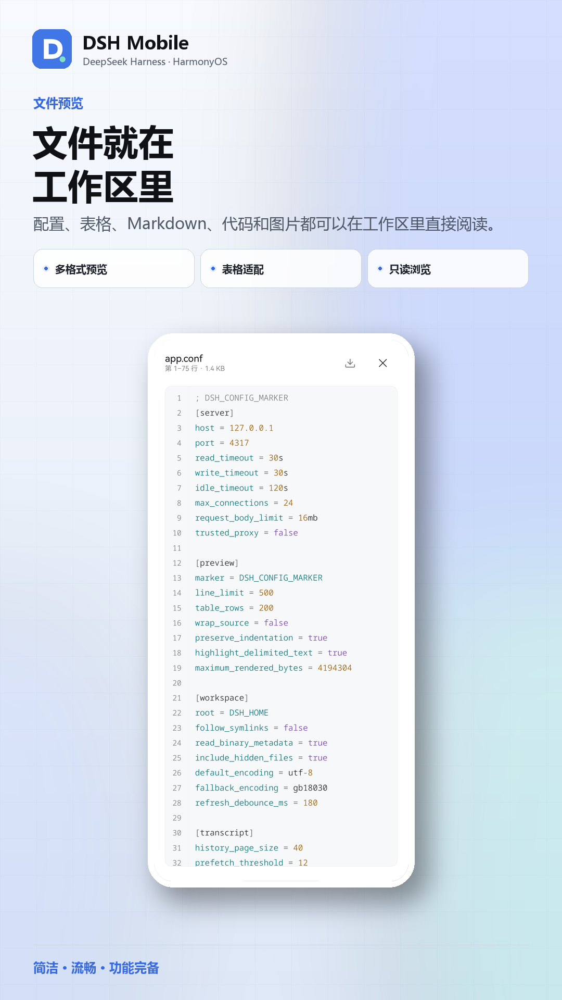
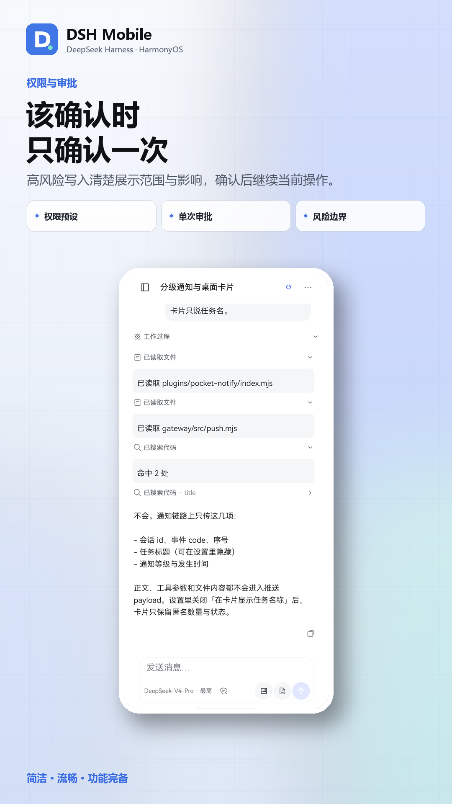
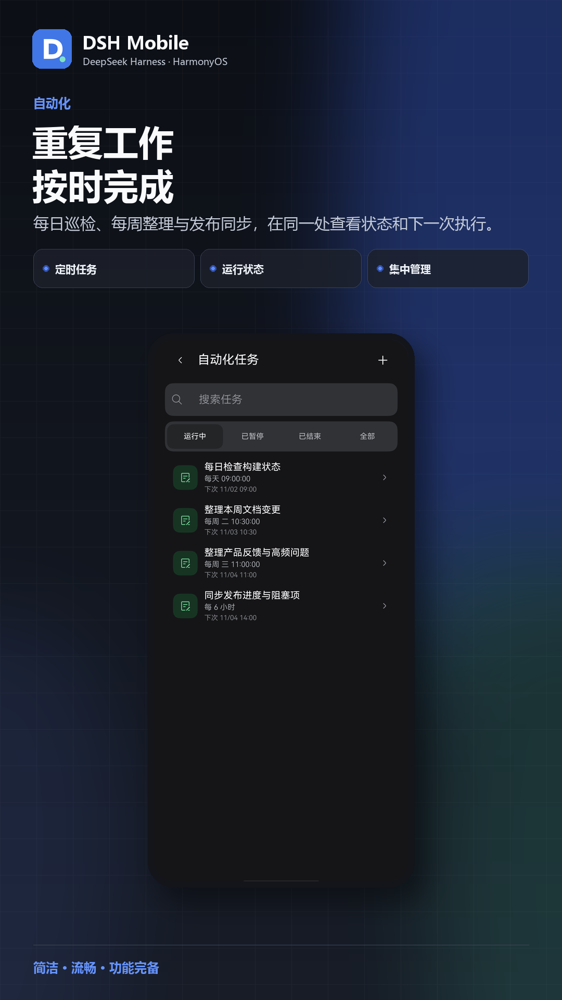
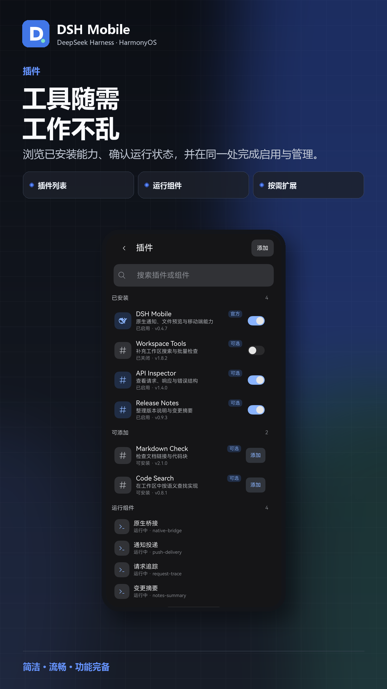
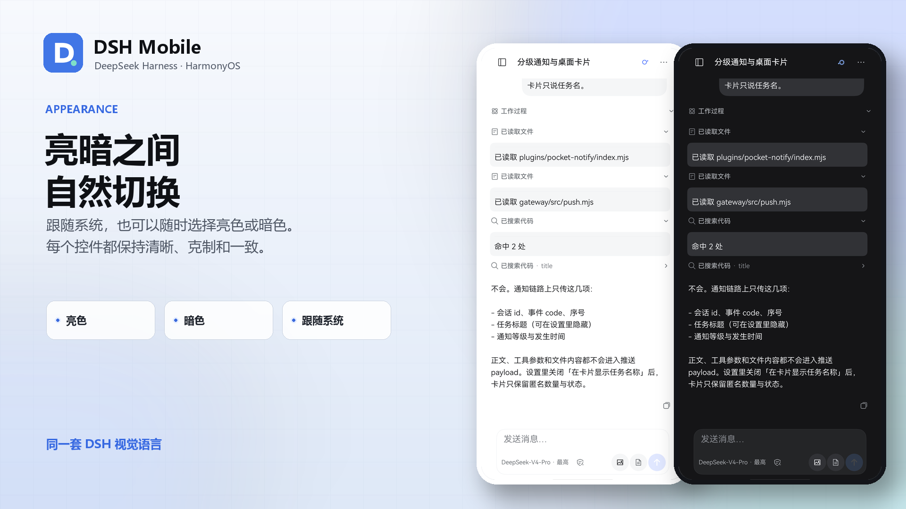
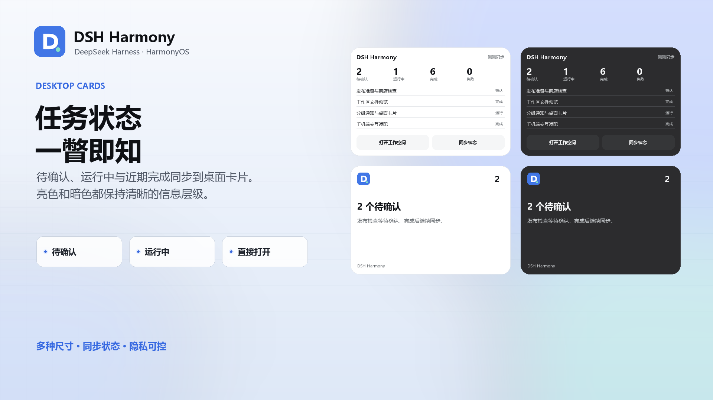

<p align="center">
  
</p>

<h1 align="center">DSH Harmony</h1>

<p align="center">
  <strong>DeepSeek Harness, made for HarmonyOS</strong><br>
  A native mobile workspace that keeps the idea, the work and the result on one line.
</p>

<p align="center">
  <a href="https://github.com/deepseek-ai/deepseek-harness">
    
  </a>
  <a href="https://github.com/deepseek-ai/deepseek-harness"><strong>DeepSeek Harness</strong></a>
  &nbsp;·&nbsp;
  
  
  
</p>

<p align="center">
  <strong>English</strong> · <a href="README.md">简体中文</a>
</p>

---

## Harness, designed for a phone

DSH Harmony brings DeepSeek Harness workspaces, sessions, tool calls and live output to HarmonyOS through an ArkUI surface redesigned for touch, keyboards, safe areas and system Back.

The goal goes beyond making Harness fit. From cold start to long-history scrolling, from a tool call to a background notification, DSH Harmony is built around less waiting, clearer state and more natural interaction.

## From an idea to a result, in one working line

Hand a task to DSH Harmony and follow it as it reads files, runs commands, reviews changes and returns a result. The process can open in place while the result stays direct; the floating task plan and live state stay attached to the current work.

<p align="center">
  
</p>

<p align="center">
  
  
  
</p>

**Clear process, direct result.** Reads, commands and changes expand in real order, and stay compact when the answer is the focus.

**Parallel work, connected context.** Plans, subagents and parent-child sessions remain visible as the work continues.

**Files live in the workspace.** Read configs, tables, Markdown, code and images in place, without breaking the flow.

## Confirm once, when confirmation is needed

Session permissions, one-shot approvals, questions and attachments stay close to the composer. Risky actions show their scope and impact; a one-shot approval never changes the session permission.

<p align="center">
  
  
  
</p>

**Explicit approval boundaries.** Allow once, reject, risk acknowledgement and submitting states each have a clear visual home.

**Repetitive work, on schedule.** Daily checks, weekly summaries and release syncs live together in one automation list.

**Tools when you need them.** Browse installed capabilities, confirm runtime state and enable or manage them in one place.

## One native workspace

DSH Harmony builds one native workspace in ArkUI: sessions, work processes, model selection, permissions, file previews, plugins and automation use DSH's visual language. It remembers the last session, workspace, scroll position and disclosure state.

Login stays flexible:

- **Harness native login** is the default and works with LAN or public deployments.
- **Pocket ID / Passkey** is optional for HTTPS environments and uses the system Passkey flow.

## Focused without getting in the way

| **Fluid** | **Focused** |
| --- | --- |
| Cache-first rendering and incremental sync preload nearby history. Stable lists and virtualized rendering keep long conversations light, while transitions follow HarmonyOS motion. | DSH's compact hierarchy and visual language keep tools, reasoning, files and messages distinct without letting chrome compete with content. |
| Press feedback, drawers, navigation, safe areas and system Back are implemented natively, with respect for reduced-motion preferences. | Sessions, models, tools, approvals, questions, images, Markdown, code, file browsing and tiered notifications cover real mobile workflows. |

<p align="center">
  
  
</p>

## Get started

Send this prompt to DSH. An agent with `plugin_manager` support will install the plugin and verify its version:

```text
Follow https://github.com/stlin256/DSH-Harmony/blob/main/docs/PLUGIN-INSTALL.md to install and enable DSH Harmony. Use dsh-harmony-plugin-0.4.0.tgz from the matching plugin-v0.4.0 release, then verify that @dsh-harmony/plugin is running and report its version.
```

You can also open **Plugins → Add plugin** in DSH and paste the same versioned tarball URL. Then open DSH Harmony, enter the service origin and choose native login or Passkey.

[Plugin installation](docs/PLUGIN-INSTALL.md) · [Deployment](docs/DEPLOYMENT.md) · [Passkey](docs/OIDC-DEPLOYMENT.md)

## Stay close to every task

DSH Harmony can send tiered HarmonyOS notifications when a task completes, fails or waits for approval. Tapping a notification returns to its session, while home-screen service widgets summarize workspaces and task state.

Community builds can use Push Kit for immediate delivery. The AppGallery build uses a store-specific configuration and provides background status monitoring where system policy allows.

## For AppGallery

<p align="left">
  <a href="https://developer.huawei.com/consumer/en/appgallery/">
    
  </a>
  <strong>HarmonyOS AppGallery · In preparation</strong>
</p>

DSH Harmony is completing its AppGallery release preparation for HarmonyOS users. The store version keeps the same fluid interface, complete session experience and DSH-native design while following AppGallery distribution and notification requirements.

## Build it with us

DSH Harmony is open source. Issues, ideas and pull requests are welcome; start with the [validation guide](docs/VALIDATION.md) and the implementation specs in the repository.

[Report an issue](https://github.com/stlin256/DSH-Harmony/issues) · [View source](https://github.com/stlin256/DSH-Harmony) · [Author](https://github.com/stlin256)

<p align="center">
  <sub>Built for HarmonyOS with care. AGPL-3.0.</sub>
</p>
